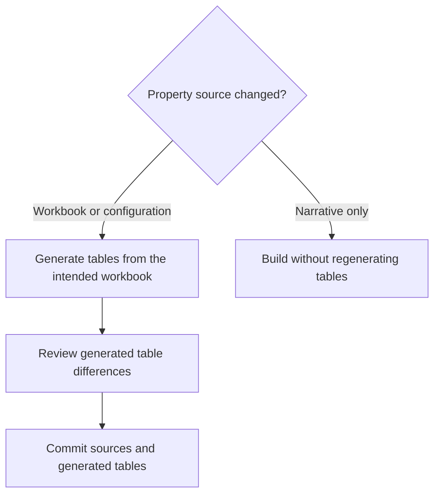
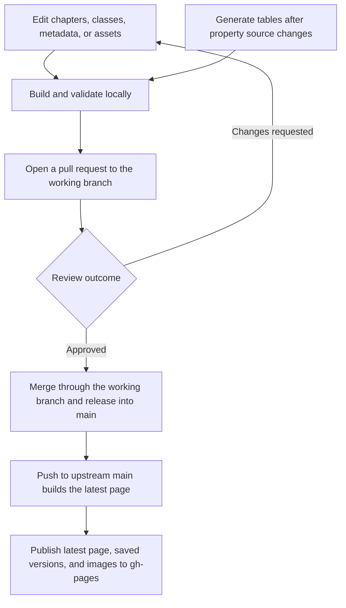

# Documentation maintainer guide

This guide explains how to edit and build the Health-RI metadata specification. For reading and citation links, see the [repository overview](../README.md). For version preparation, saved specifications, and publication troubleshooting, see the [release guide](../releases/README.md).

## Source locations and editing rules

| Content | Location from the repository root | Maintenance |
|---------|-----------------------------------|-------------|
| Specification structure and publication metadata | `index.bs` | Edit the document configuration and includes here. |
| Narrative chapters | `src/chapter/*.md` | Edit explanatory documentation here. |
| Class descriptions | `src/class/*.md` | Edit class-level documentation here. |
| Property definitions | `src/excel/HealthRI_v*.xlsx` | Source of truth for property metadata; use the intended version's workbook. |
| Vocabulary mappings and property links | `src/python/links.json` | Configuration used by the property-table generator. |
| Property tables | `src/property/*.html` | Generated from Excel; regenerate rather than edit manually. |
| Styling and presentation scripts | `src/table/*.md` | Included by Bikeshed. |
| Images and diagrams | `src/images/` | Maintain assets referenced by the specification. |
| Generator and version checker | `src/python/` | Python utilities and regression tests. |
| Publication workflow | `.github/workflows/publish.yml` | Builds and publishes the specification. |
| Version check workflow | `.github/workflows/version-consistency.yml` | Tests the version checker and checks current version references. |
| Rendered HTML | `index.html` | Generated output; do not edit manually. |
| Saved specifications | `releases/vX.Y.Z/` | Commit the HTML and required assets for each release; preserve published versions. |
| Deployed site | `gh-pages` branch | Generated publication output. |

Edit source files rather than generated HTML. Regenerate property tables when their workbook or generator configuration changes; narrative-only changes do not require regenerating them. Review generated differences before committing.

Run the commands below from the repository root.

## Generate property tables

Install the generator's Python dependencies:

```bash
python -m pip install pandas openpyxl
```

Select the intended workbook explicitly. For v2.1.0:

```bash
python src/python/Excel_To_Html.py --excel src/excel/HealthRI_v2.1.0.xlsx
```

The generator writes `src/property/*.html`. Without `--excel`, it selects the workbook with the most recent modification timestamp, not the highest version number; tied timestamps require explicit selection. Commit the workbook or configuration changes together with their generated tables.



## Build and validate locally

Install Bikeshed and update its supporting data:

```bash
pipx install bikeshed
bikeshed update
```

Generate a preview and open it in a browser to check the text, tables, links, and images:

```bash
bikeshed spec index.bs preview.html
```

For a build without an output file:

```bash
bikeshed --dry-run spec index.bs
```

Run the existing version checker and Python regression tests:

```bash
python src/python/check_version_consistency.py
python -B -m unittest discover -s src/python/tests -v
```

The version checker compares the status version, UML heading, and UML image reference; it does not check every release-related field. Review the remaining metadata using the [release checklist](../releases/README.md#prepare-and-save-a-version).

## Build and publication workflow



The [publication workflow](../.github/workflows/publish.yml) builds the specification for pull requests targeting `main`. A push to upstream `main` builds and publishes the latest specification, then copies committed saved versions and images to GitHub Pages. It does not regenerate property tables or saved version HTML. Pull requests targeting `v2.1` do not trigger that publication workflow; use a local build to preview them. The version consistency workflow runs on pushes and pull requests.

## Reference resources

| Resource | Purpose |
|----------|---------|
| [Metadata repository](https://github.com/Health-RI/health-ri-metadata) | Schema artifacts, SHACL shapes, releases, and all issue tracking |
| [Bikeshed documentation](https://speced.github.io/bikeshed/) | Specification build tool |
| [DCAT 3](https://www.w3.org/TR/vocab-dcat-3/) | W3C Data Catalog Vocabulary |
| [DCAT-AP NL 3.0](https://docs.geostandaarden.nl/dcat/dcat-ap-nl30/) | Dutch DCAT application profile |
| [HealthDCAT-AP](https://healthdataeu.pages.code.europa.eu/healthdcat-ap/) | Health domain DCAT profile |
